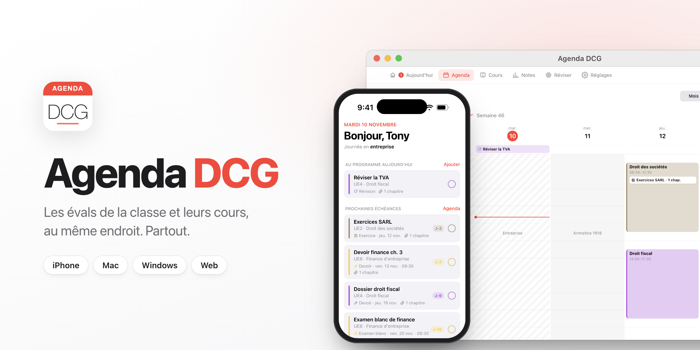
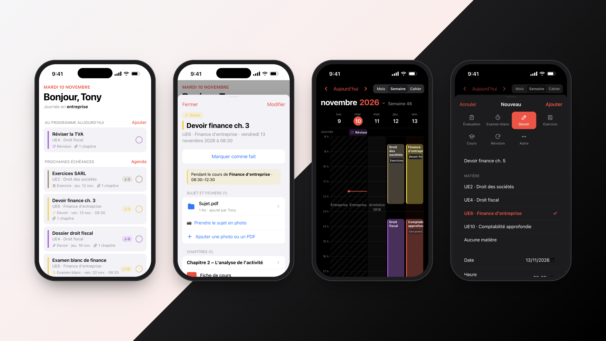
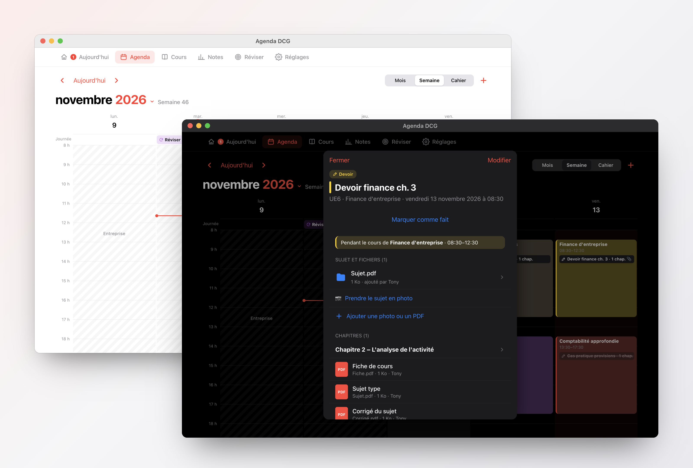
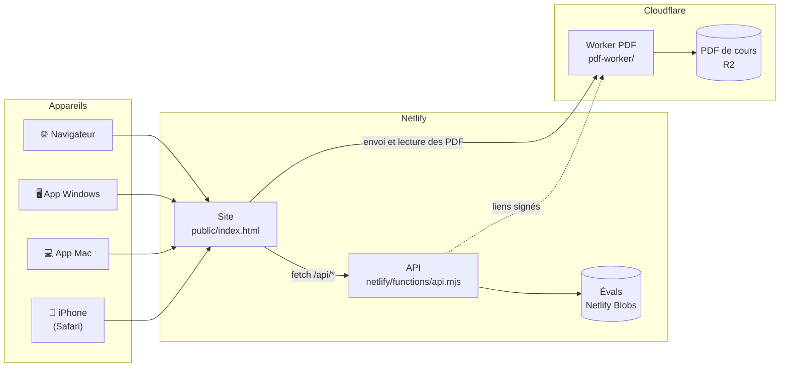
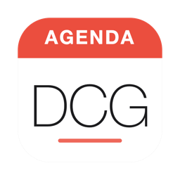

<div align="center">



<br>

[](https://github.com/Tauwni/AgendaDCG/releases/latest)
[](https://github.com/Tauwni/AgendaDCG/releases)
[](https://github.com/Tauwni/AgendaDCG/actions/workflows/desktop.yml)
[](https://agendadcg.netlify.app)
[](LICENSE)

**L'agenda partagé des évaluations de la classe, avec les cours en PDF pour chaque éval.**<br>
Un style Calendrier d'Apple, disponible sur iPhone, Mac, Windows et dans le navigateur, toujours synchronisé.

<br>

<a href="https://github.com/Tauwni/AgendaDCG/releases/latest/download/Agenda-DCG-Mac.dmg"></a>
&nbsp;
<a href="https://github.com/Tauwni/AgendaDCG/releases/latest/download/Agenda-DCG-Windows-Setup.exe"></a>
&nbsp;
<a href="https://agendadcg.netlify.app"></a>

<sub>Mac Intel et Apple Silicon · Windows 10 et 11 (x64 et ARM) · iPhone avec Safari</sub>

</div>

<br>

## Aperçu

<p align="center">
  
</p>

<p align="center">
  
</p>

## Fonctionnalités

<table>
<tr>
<td width="50%" valign="top">

### 📅 Un vrai agenda
Vue mois et vue semaine : on passe de l'une à l'autre en pinçant l'écran, on glisse de semaine en semaine, et on choisit directement le mois en touchant son nom. Les jours fériés sont indiqués. Évaluations, examens blancs, devoirs, exercices, cours et révisions ont chacun leur icône.

</td>
<td width="50%" valign="top">

### 📚 Une bibliothèque de cours
Les PDF sont rangés par matière, puis par chapitre. Chaque chapitre a sa fiche de cours, son sujet type et le corrigé du sujet. Une éval ou un exercice renvoie aux chapitres concernés, et on ouvre les PDF directement en ligne.

</td>
</tr>
<tr>
<td valign="top">

### 👥 Partagé, avec un espace privé
L'agenda et les cours sont communs à la classe (un mot de passe de classe). Chacun a aussi son compte, protégé par un code perso à 6 chiffres, pour ses notes, ce qu'il a déjà fait et ses rappels, sur tous ses appareils.

</td>
<td valign="top">

### 🔄 Synchronisé partout
Le site, l'app Mac, l'app Windows et l'iPhone utilisent les mêmes données. Une éval ajoutée sur le téléphone apparaît tout de suite sur l'ordinateur.

</td>
</tr>
<tr>
<td valign="top">

### 🌙 Clair, sombre et fluide
L'interface suit le thème de l'appareil, avec les couleurs, la typographie et les animations d'iOS et de macOS : mois qui glissent sous le doigt, fenêtres qu'on ferme en les tirant vers le bas.

</td>
<td valign="top">

### 📲 Comme une app sur iPhone
Dans Safari : **Partager → Sur l'écran d'accueil**. L'agenda s'ouvre alors en plein écran, comme une app.

</td>
</tr>
<tr>
<td valign="top">

### 🗜️ PDF compressés automatiquement
Avant l'envoi, les images des PDF (scans, photos) sont recompressées dans le navigateur : un scan de 20 Mo passe souvent sous les 3 Mo. Le texte reste sélectionnable. Un PDF déjà léger est envoyé tel quel.

</td>
<td valign="top">

### 📸 Photos converties en PDF
Envoie des photos PNG ou JPG, par exemple le tableau ou des notes prises au téléphone : elles deviennent un PDF. Plusieurs photos choisies ensemble sont réunies dans un seul PDF.

</td>
</tr>
<tr>
<td valign="top">

### ☀️ Aujourd'hui
En ouvrant l'appli : ce qui est prévu aujourd'hui, ce qui est en retard et les prochaines échéances. On coche ce qui est fait.

</td>
<td valign="top">

### 📈 Carnet de notes
Moyennes par matière, graphique d'évolution et simulateur « quelle note me faut-il au prochain contrôle ». Moyennes indicatives, pas les règles officielles du DCG.

</td>
</tr>
<tr>
<td valign="top">

### 🔔 Notifications
Chacun choisit : à chaque nouvelle évaluation, chaque matin, chaque dimanche, et des rappels 1 jour, 2 jours ou 1 semaine avant. Sur iPhone, après avoir ajouté l'agenda à l'écran d'accueil.

</td>
<td valign="top">

</td>
</tr>
</table>

## Installation

**Page de présentation et téléchargements : [agendadcg.netlify.app/presentation](https://agendadcg.netlify.app/presentation)**

### Avec un agent IA

Colle ce prompt dans Claude Code, Codex, Cursor ou tout agent qui peut lancer des commandes :

```text
Installe l'application Agenda DCG sur cet ordinateur.

Télécharge la dernière version depuis https://github.com/Tauwni/AgendaDCG/releases/latest
- Sur Mac : prends Agenda-DCG-Mac.dmg, copie « Agenda DCG » dans le dossier Applications, retire l'attribut de quarantaine de l'app (elle n'est pas signée par Apple), puis ouvre-la.
- Sur Windows : prends Agenda-DCG-Windows-Setup.exe, lance l'installation, puis ouvre l'app.

Dis-moi quand c'est fait.
```

### À la main

| Appareil | Comment faire |
| --- | --- |
| **Mac** | Télécharge [`Agenda-DCG-Mac.dmg`](https://github.com/Tauwni/AgendaDCG/releases/latest/download/Agenda-DCG-Mac.dmg), ouvre-le et glisse l'app dans **Applications**. |
| **Windows** | Télécharge [`Agenda-DCG-Windows-Setup.exe`](https://github.com/Tauwni/AgendaDCG/releases/latest/download/Agenda-DCG-Windows-Setup.exe) et lance-le. Un raccourci est créé sur le bureau. |
| **iPhone** | Ouvre [le site](https://agendadcg.netlify.app) dans Safari, puis **Partager → Sur l'écran d'accueil**. |
| **Navigateur** | Va sur **[agendadcg.netlify.app](https://agendadcg.netlify.app)**. |

Au premier lancement, l'agenda demande ton prénom et le mot de passe de la classe, puis te fait créer un code perso à 6 chiffres. Sur un autre appareil, ton prénom et ton code suffisent pour retrouver ton compte. Le mot de passe de la classe se demande au délégué : il n'est écrit nulle part dans ce dépôt.

<details>
<summary><b>macOS dit que l'app « ne peut pas être ouverte » ?</b></summary>

<br>

L'app n'est pas signée avec un certificat Apple payant, donc macOS la bloque la première fois.

1. Essaie d'ouvrir **Agenda DCG** une première fois et ferme le message.
2. Ouvre **Réglages Système → Confidentialité et sécurité**.
3. En bas, à côté de « Agenda DCG a été bloquée », clique sur **Ouvrir quand même**.

Il n'y a besoin de le faire qu'une seule fois.

</details>

<details>
<summary><b>Windows affiche « Windows a protégé votre ordinateur » ?</b></summary>

<br>

C'est SmartScreen, qui se méfie des apps sans certificat payant. Clique sur **Informations complémentaires**, puis sur **Exécuter quand même**.

</details>

## Comment ça marche



Les PDF ne passent pas par Netlify. L'API donne au navigateur un lien signé valable quelques minutes, et le navigateur envoie ou lit le PDF directement sur le Worker Cloudflare, qui le stocke dans R2. Sans lien signé, le Worker refuse tout accès.

Les apps Mac et Windows sont de **vraies applications natives** (SwiftUI sur Mac, WPF/.NET sur Windows) qui parlent à la même API que le site : tout reste synchronisé. Elles sont légères (quelques Mo sur Mac), lisent les PDF en natif, programment les rappels dans le système et **se mettent à jour toutes seules** à partir des releases GitHub.

| Partie | Technologie |
| --- | --- |
| Interface | HTML, CSS et JavaScript, sans framework |
| API | [Netlify Functions](https://docs.netlify.com/functions/overview/) (Node.js) |
| Stockage | [Netlify Blobs](https://docs.netlify.com/blobs/overview/) pour les évals, [Cloudflare R2](https://developers.cloudflare.com/r2/) pour les PDF |
| PDF | [Cloudflare Worker](https://developers.cloudflare.com/workers/) avec liens signés (HMAC) |
| Connexion | Mot de passe partagé, cookie de session `HttpOnly` signé |
| Compression et conversion | [pdf-lib](https://pdf-lib.js.org/) et Canvas, directement dans le navigateur |
| Garde-fou gratuit | [Durable Object](https://developers.cloudflare.com/durable-objects/) qui compte le stockage et les opérations R2 |
| App Mac | [SwiftUI](https://developer.apple.com/xcode/swiftui/), PDFKit, Swift Charts, notifications locales |
| App Windows | [WPF](https://learn.microsoft.com/dotnet/desktop/wpf/) (.NET 8), notifications Windows, installeur et mises à jour [Velopack](https://velopack.io/) |
| Builds | [GitHub Actions](https://github.com/Tauwni/AgendaDCG/actions) sur macOS et Windows |

## Développement

<details>
<summary><b>Lancer le projet en local</b></summary>

<br>

Il faut [Node.js](https://nodejs.org/) 20 ou plus et la [CLI Netlify](https://docs.netlify.com/cli/get-started/).

```bash
git clone https://github.com/Tauwni/AgendaDCG.git
cd AgendaDCG
npm install
netlify dev
```

L'agenda tourne alors sur http://localhost:8888.

Pour envoyer des PDF en local, lance aussi le Worker (R2 est simulé sur ta machine) :

```bash
cd pdf-worker
npm install
echo "SIGNING_SECRET=un-secret" > .dev.vars
npx wrangler dev --port 8787
```

et crée un `.env` à la racine du projet avec `PDF_WORKER_URL=http://localhost:8787` et `PDF_SIGNING_SECRET=un-secret`. Sans Worker, l'agenda garde l'ancien envoi via Netlify, limité à 5,5 Mo.

</details>

<details>
<summary><b>Lancer les apps de bureau</b></summary>

<br>

**Mac** (Swift 5.10+ ; `AGENDA_SITE` permet de viser un serveur local) :

```bash
cd native/mac
VERSION=2.0.0 ./build-app.sh
open "dist/Agenda DCG.app"
```

**Windows** (.NET 8 SDK) :

```bash
cd native/windows/AgendaDCG
dotnet run
```

</details>

<details>
<summary><b>Publier une nouvelle version</b></summary>

<br>

**Le site :**

```bash
netlify deploy --prod
```

**Les apps :** pousse un tag de version, rien d'autre à modifier :

```bash
git tag v2.0.1
git push origin v2.0.1
```

[GitHub Actions](.github/workflows/desktop.yml) construit l'app Mac (`.dmg` + `.zip`) et l'app Windows (installeur Velopack), les publie dans une nouvelle [release](https://github.com/Tauwni/AgendaDCG/releases), et les apps déjà installées se mettent à jour d'elles-mêmes.

</details>

<details>
<summary><b>Structure du projet</b></summary>

<br>

```
AgendaDCG/
├── public/
│   ├── index.html          # Interface : calendrier, évals et exercices, bibliothèque de cours
│   └── pdf-tools.js        # Compression des PDF et conversion des photos
├── netlify/functions/
│   └── api.mjs             # API : connexion, évals, chapitres, PDF
├── pdf-worker/
│   └── src/index.js        # Worker Cloudflare : envoi et lecture des PDF dans R2
├── native/
│   ├── mac/                # App Mac native (SwiftUI) + build-app.sh
│   ├── windows/AgendaDCG/  # App Windows native (WPF, .NET 8)
│   └── assets/icon.svg     # Icône des apps
├── .github/workflows/
│   └── desktop.yml         # Build des apps Mac et Windows
└── netlify.toml
```

</details>

## Limites

- Un PDF ne peut pas dépasser **100 Mo** (limite d'envoi des Workers Cloudflare gratuits).
- Pour que l'agenda reste **toujours gratuit**, le Worker bloque avant de dépasser le forfait gratuit de Cloudflare R2 :

  | | Forfait gratuit | Blocage à |
  | --- | --- | --- |
  | Stockage | 10 Go | 9,5 Go : envois refusés jusqu'à ce qu'on supprime des PDF |
  | Envois | 1 million par mois | 950 000 : envois refusés jusqu'au 1er du mois |
  | Lectures | 10 millions par mois | 9,5 millions : ouverture des PDF refusée jusqu'au 1er du mois |

  L'espace utilisé s'affiche dans l'agenda, en touchant son prénom en haut à droite.
- Il faut internet : l'agenda ne fonctionne pas hors ligne.

## Licence

[MIT](LICENSE) © Tauwni

<div align="center">
<br>

<br>
<sub>Fait pour la classe de DCG</sub>
</div>

## Organisation du site (dossier `public/`)

| Fichier | Rôle |
| --- | --- |
| `index.html` | Squelette de la page : écran de connexion, onglets, chargement des fichiers |
| `app.css` | Toute la mise en forme |
| `js/core.js` | État, outils communs, appels au serveur |
| `js/reviser.js` | Onglet Réviser, niveaux par matière, méthodes et créneaux de révision |
| `js/session.js` | Emploi du temps, connexion, onglets, statut « fait », carte d'un événement |
| `js/today.js` | Écran Aujourd'hui |
| `js/agenda.js` | Agenda : mois, semaine, cahier de texte |
| `js/events.js` | Devoirs et évaluations : création, modification, fiche, pièces jointes |
| `js/cours.js` | Bibliothèque de cours, PDF, recherche dans le texte |
| `js/settings.js` | Notifications, mise à jour, Réglages, démarrage |
| `tts.js` | Lecture à voix haute des PDF |
| `pdf-tools.js` | Compression et conversion des PDF avant envoi |
| `sw.js` | Mode hors ligne et notifications push |
| `admin.html` | Tableau de bord privé (statistiques, emploi du temps, corbeille) |

Les fichiers de `js/` sont de simples scripts chargés dans l'ordre ci-dessus : ils partagent les mêmes variables. Si on ajoute un fichier, il faut l'ajouter dans `index.html` **et** dans la liste `ASSETS` de `sw.js`.

Le tag git `avant-refonte-accueil` garde l'état d'avant la refonte de l'accueil et de l'onglet Réviser (v2.1.8).
