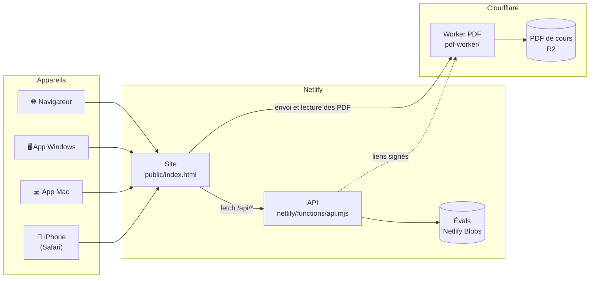

<div align="center">


<br>

[](https://github.com/Tauwni/AgendaDCG/releases/latest)
[](https://github.com/Tauwni/AgendaDCG/releases)
[](https://github.com/Tauwni/AgendaDCG/actions/workflows/desktop.yml)
[](https://agenda-evals-0885.netlify.app)
[](LICENSE)

**L'agenda partagé des évaluations de la classe, avec les cours en PDF pour chaque éval.**<br>
Un style Calendrier d'Apple, disponible sur iPhone, Mac, Windows et dans le navigateur, toujours synchronisé.

<br>

<a href="https://github.com/Tauwni/AgendaDCG/releases/latest/download/Agenda-DCG-Mac.dmg"></a>
&nbsp;
<a href="https://github.com/Tauwni/AgendaDCG/releases/latest/download/Agenda-DCG-Windows-Setup.exe"></a>
&nbsp;
<a href="https://agenda-evals-0885.netlify.app"></a>

<sub>Mac Intel et Apple Silicon · Windows 10 et 11 (x64 et ARM) · iPhone avec Safari</sub>

</div>

<br>

## Aperçu

<p align="center">
  
</p>

<p align="center">
  
</p>

## Fonctionnalités

<table>
<tr>
<td width="50%" valign="top">

### 📅 Un vrai calendrier
Vue du mois façon Apple, pastilles de couleur par éval, liste du jour et prochaines évals. Sur iPhone, on change de mois en balayant l'écran.

</td>
<td width="50%" valign="top">

### 📎 Les cours avec chaque éval
Chaque éval peut avoir un ou plusieurs PDF. On les ouvre directement en ligne, sans rien télécharger.

</td>
</tr>
<tr>
<td valign="top">

### 👥 Pensé pour la classe
Un seul mot de passe pour toute la classe. Chacun indique son prénom, et l'historique montre qui a créé, modifié ou ajouté quoi.

</td>
<td valign="top">

### 🔄 Synchronisé partout
Le site, l'app Mac, l'app Windows et l'iPhone utilisent les mêmes données. Une éval ajoutée sur le téléphone apparaît tout de suite sur l'ordinateur.

</td>
</tr>
<tr>
<td valign="top">

### 🌙 Clair et sombre
L'interface suit le thème de l'appareil, avec les couleurs et la typographie d'iOS et de macOS.

</td>
<td valign="top">

### 📲 Comme une app sur iPhone
Dans Safari : **Partager → Sur l'écran d'accueil**. L'agenda s'ouvre alors en plein écran, comme une app.

</td>
</tr>
</table>

## Installation

| Appareil | Comment faire |
| --- | --- |
| **Mac** | Télécharge [`Agenda-DCG-Mac.dmg`](https://github.com/Tauwni/AgendaDCG/releases/latest/download/Agenda-DCG-Mac.dmg), ouvre-le et glisse l'app dans **Applications**. |
| **Windows** | Télécharge [`Agenda-DCG-Windows-Setup.exe`](https://github.com/Tauwni/AgendaDCG/releases/latest/download/Agenda-DCG-Windows-Setup.exe) et lance-le. Un raccourci est créé sur le bureau. |
| **iPhone** | Ouvre [le site](https://agenda-evals-0885.netlify.app) dans Safari, puis **Partager → Sur l'écran d'accueil**. |
| **Navigateur** | Va sur **[agenda-evals-0885.netlify.app](https://agenda-evals-0885.netlify.app)**. |

Le mot de passe de la classe se demande au délégué. Il n'est écrit nulle part dans ce dépôt.

<details>
<summary><b>macOS dit que l'app « ne peut pas être ouverte » ?</b></summary>

<br>

L'app n'est pas signée avec un certificat Apple payant, donc macOS la bloque la première fois.

1. Essaie d'ouvrir **Agenda DCG** une première fois et ferme le message.
2. Ouvre **Réglages Système → Confidentialité et sécurité**.
3. En bas, à côté de « Agenda DCG a été bloquée », clique sur **Ouvrir quand même**.

Il n'y a besoin de le faire qu'une seule fois.

</details>

<details>
<summary><b>Windows affiche « Windows a protégé votre ordinateur » ?</b></summary>

<br>

C'est SmartScreen, qui se méfie des apps sans certificat payant. Clique sur **Informations complémentaires**, puis sur **Exécuter quand même**.

</details>

## Comment ça marche



Les PDF ne passent pas par Netlify. L'API donne au navigateur un lien signé valable quelques minutes, et le navigateur envoie ou lit le PDF directement sur le Worker Cloudflare, qui le stocke dans R2. Sans lien signé, le Worker refuse tout accès.

Les apps Mac et Windows sont des fenêtres [Electron](https://www.electronjs.org/) qui affichent le site. Il n'y a qu'une seule interface et une seule source de données, donc rien à synchroniser à la main, et les apps profitent de chaque mise à jour du site sans être réinstallées.

| Partie | Technologie |
| --- | --- |
| Interface | HTML, CSS et JavaScript, sans framework |
| API | [Netlify Functions](https://docs.netlify.com/functions/overview/) (Node.js) |
| Stockage | [Netlify Blobs](https://docs.netlify.com/blobs/overview/) pour les évals, [Cloudflare R2](https://developers.cloudflare.com/r2/) pour les PDF |
| PDF | [Cloudflare Worker](https://developers.cloudflare.com/workers/) avec liens signés (HMAC) |
| Connexion | Mot de passe partagé, cookie de session `HttpOnly` signé |
| Apps de bureau | [Electron](https://www.electronjs.org/) et [electron-builder](https://www.electron.build/) |
| Builds | [GitHub Actions](https://github.com/Tauwni/AgendaDCG/actions) sur macOS et Windows |

## Développement

<details>
<summary><b>Lancer le projet en local</b></summary>

<br>

Il faut [Node.js](https://nodejs.org/) 20 ou plus et la [CLI Netlify](https://docs.netlify.com/cli/get-started/).

```bash
git clone https://github.com/Tauwni/AgendaDCG.git
cd AgendaDCG
npm install
echo "AGENDA_PASSWORD=un-mot-de-passe" > .env
netlify dev
```

L'agenda tourne alors sur http://localhost:8888.

Pour envoyer des PDF en local, lance aussi le Worker (R2 est simulé sur ta machine) :

```bash
cd pdf-worker
npm install
echo "SIGNING_SECRET=un-secret" > .dev.vars
npx wrangler dev --port 8787
```

et ajoute au `.env` du projet `PDF_WORKER_URL=http://localhost:8787` et `PDF_SIGNING_SECRET=un-secret`. Sans Worker, l'agenda garde l'ancien envoi via Netlify, limité à 5,5 Mo.

</details>

<details>
<summary><b>Lancer l'app de bureau</b></summary>

<br>

```bash
cd desktop
npm install
npm start
```

</details>

<details>
<summary><b>Publier une nouvelle version</b></summary>

<br>

**Le site :**

```bash
netlify deploy --prod
```

**Les apps :** augmente `version` dans [`desktop/package.json`](desktop/package.json), puis pousse un tag :

```bash
git tag v1.0.1
git push origin v1.0.1
```

[GitHub Actions](.github/workflows/desktop.yml) construit le `.dmg` et le `.exe`, puis les publie dans une nouvelle [release](https://github.com/Tauwni/AgendaDCG/releases).

</details>

<details>
<summary><b>Structure du projet</b></summary>

<br>

```
AgendaDCG/
├── public/
│   └── index.html          # Interface : calendrier, fiches d'éval, envoi de PDF
├── netlify/functions/
│   └── api.mjs             # API : connexion, évals, PDF
├── pdf-worker/
│   └── src/index.js        # Worker Cloudflare : envoi et lecture des PDF dans R2
├── desktop/
│   ├── main.js             # Fenêtre Electron
│   ├── offline.html        # Écran affiché sans connexion
│   └── build/icon.svg      # Icône de l'app
├── .github/workflows/
│   └── desktop.yml         # Build des apps Mac et Windows
└── netlify.toml
```

</details>

## Limites

- Un PDF ne peut pas dépasser **100 Mo** (limite d'envoi des Workers Cloudflare gratuits).
- Il faut internet : l'agenda ne fonctionne pas hors ligne.

## Licence

[MIT](LICENSE) © Tauwni

<div align="center">
<br>

<br>
<sub>Fait pour la classe de DCG</sub>
</div>
